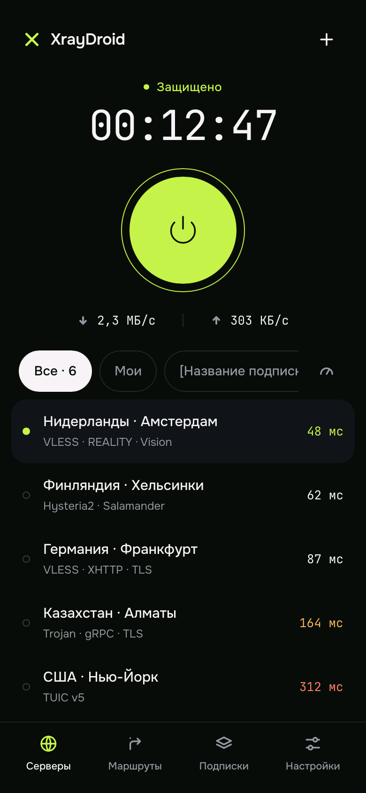
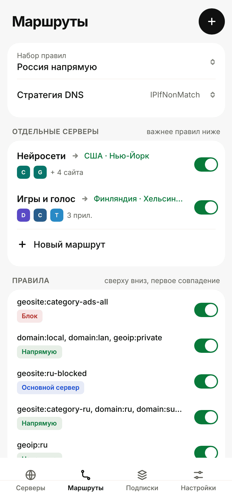
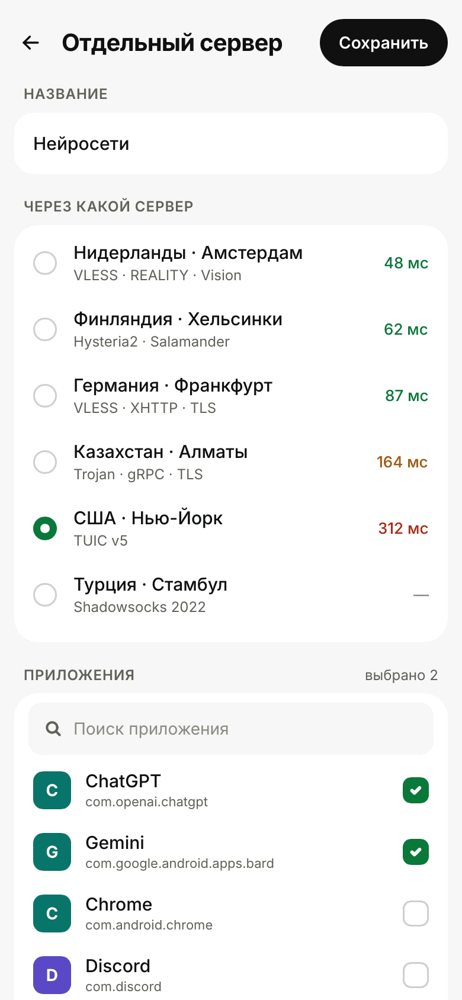
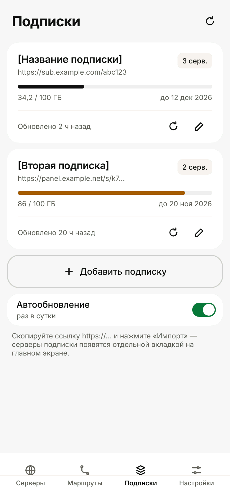

# XrayDroid

VPN-клиент для Android в духе **v2rayN / v2rayNG**, полностью написанный на **Rust**: собственное ядро протоколов и минималистичный интерфейс на [Slint](https://slint.dev) (светлая и тёмная тема). На Java — только обязательная прослойка Android (`NativeActivity`, `VpnService`, плитка в шторке).

| Серверы | Маршруты | Отдельный сервер | Подписки |
|---|---|---|---|
|  |  |  |  |

## Возможности

**Протоколы** (собственная реализация, проверена против Xray-core 26.3):
- **VLESS**:
  - **XTLS Vision** (`xtls-rprx-vision`, `-udp443`) поверх REALITY, обычного TLS 1.3 или VLESS Encryption — с переходом в direct-режим, как в Xray;
  - **VLESS Encryption** — постквантовое шифрование Xray (`mlkem768x25519plus`: ML-KEM-768 + X25519, режимы `native`/`xorpub`/`random`, паддинг);
  - UDP: обычный, а через Vision — **XUDP** (Mux.Cool), как в Xray;
  - для Vision+TLS — собственный TLS 1.3-клиент с полной проверкой сертификата (цепочка, имя, CertificateVerify).
- VMess AEAD (`auto`, `aes-128-gcm`, `chacha20-poly1305`, `none`, `zero`)
- Trojan
- Shadowsocks: AEAD, 2022 (`2022-blake3-*`), `xchacha20-ietf-poly1305` и старые потоковые шифры; поверх любого транспорта (WebSocket, gRPC, TLS — как в Xray) и с `v2ray-plugin` в режиме websocket
- **Hysteria2** (QUIC, аутентификация по HTTP/3, UDP-датаграммы с фрагментацией, обфускация **Salamander**, **port hopping** — `host:443,20000-30000` или `mport=`)
- **TUIC v5** (QUIC, токен из TLS Keying Material, UDP в режимах `native` и `quic`, выбор congestion control: bbr / cubic / new_reno)
- **AnyTLS** (sing-box): сессии переиспользуются, UDP через UDP-over-TCP v2, отпечаток Chrome при `fp=`
- **NaiveProxy** — HTTP/2 CONNECT с отпечатком Chrome и паддингом
- **WireGuard** — в том числе Cloudflare WARP (`reserved`), pre-shared key, IPv4 и IPv6 внутри туннеля; поверх туннеля работает собственный TCP/IP-стек, домены разрешаются через сам туннель
- SOCKS5 (TCP и UDP ASSOCIATE), HTTP/HTTPS-прокси (CONNECT)

**Транспорты:**
- TCP (raw), в том числе с HTTP-маскировкой (`headerType=http`)
- TLS и REALITY; при `fp=chrome` (и других отпечатках) обычный TLS идёт с ClientHello как у Chrome — как uTLS в Xray; для серверов только с TLS 1.2 — автоматический откат на стандартный TLS
- проверка сертификата как в Xray 26: закрепление по SHA-256 (`pcs` / `pinnedPeerCertSha256`) — для самоподписанных сертификатов и чужого SNI, проверка по другому имени (`vcn` / `verifyPeerCertByName`), а также старый `allowInsecure`; для Hysteria2 — `pinSHA256`
- WebSocket (с ранними данными `?ed=2048` — первые байты уходят прямо в рукопожатии), HTTPUpgrade
- gRPC — режимы `gun` и `multi`, h2c / TLS / REALITY
- XHTTP (SplitHTTP) — режимы `auto`, `stream-one`, `stream-up`, `packet-up`, h2c / TLS / REALITY

**Качество соединения:**
- gRPC, XHTTP и NaiveProxy **переиспользуют соединения HTTP/2**: новый поток открывается без нового TCP- и TLS-рукопожатия; соединение проверяется PING-ами и заменяется, если сервер перестал отвечать или исчерпан лимит запросов (как xmux в Xray);
- **фрагментация TLS ClientHello** (переключатель в настройках) — рукопожатие уходит несколькими TLS-записями с паузами, чтобы DPI не увидел SNI; работает с TLS и REALITY;
- у сервера несколько адресов — соединение пробуется по всем сразу со сдвигом (Happy Eyeballs), запоминается рабочий; результаты DNS кэшируются, а если резолвер не ответил (смена сети) — берётся прежний адрес;
- TCP keepalive на исходящих соединениях; Hysteria2 переподключается, если сервер перестал отвечать.

Hysteria2, TUIC, AnyTLS, NaiveProxy и WireGuard проверены против sing-box 1.14, остальное — против Xray-core 26.3; все комбинации — в обе стороны (скачивание и загрузка по 20 МБ). UDP работает через VLESS, VMess, Trojan, Shadowsocks, SOCKS5, Hysteria2, TUIC, AnyTLS и WireGuard.

**Интерфейс:** четыре вкладки — серверы, маршруты, подписки, настройки; тёмная и светлая тема, шрифты Onest и JetBrains Mono (встроены в приложение, лицензия OFL — `app/ui/fonts`). На главном экране — статус, время с момента подключения и текущая скорость. Короткое нажатие на сервер выбирает его, долгое открывает лист действий (подключиться, проверить, изменить, поделиться, удалить); кнопка «+» — импорт, подписка, ручное добавление и операции над списком; значок со спидометром рядом с группами проверяет задержку всей группы.

**Как в v2rayNG:**
- импорт ссылок `vless:// vmess:// trojan:// ss:// hysteria2:// hy2:// tuic:// anytls:// naive+https:// wireguard:// socks:// http(s)://` из буфера обмена, экспорт и шаринг;
- импорт **конфигураций**: Clash / Mihomo (YAML, раздел `proxies`), sing-box (JSON, `outbounds` и `endpoints`), Xray / v2ray (JSON — одна конфигурация или массив, как отдают некоторые панели), SIP008; формат определяется сам — и для буфера обмена, и для подписок;
- **подписки**: добавление по URL (или просто скопируйте `https://…` и нажмите «Импорт»), вкладка для каждой подписки, название и остаток трафика/срок из заголовков `profile-title` и `subscription-userinfo`, автообновление раз в сутки; **пустые группы** — вкладка без ссылки и без загрузки подписки, куда попадают серверы, добавленные через «+» или импорт, пока она открыта;
- тест реальной задержки для всех серверов, сортировка, удаление дубликатов и недоступных;
- раздельное туннелирование по приложениям (только выбранные / все, кроме выбранных);
- локальный SOCKS5-прокси, плитка в шторке быстрых настроек, уведомление со скоростью.

**Маршрутизация** (как в Xray):
- правила по доменам: `domain:`, `full:`, `keyword:`, `regexp:`, `geosite:категория[@атрибут]`;
- по IP: адреса и подсети IPv4/IPv6, `geoip:ru`, `geoip:private`, `!geoip:…`;
- по портам, сети (TCP/UDP) и протоколу из сниффинга (`tls`, `http`);
- **отдельные серверы**: трафик выбранных приложений и сайтов идёт через свой сервер, а не через основной; такие маршруты проверяются раньше обычных правил. Приложение определяется по UID соединения (`getConnectionOwnerUid`, Android 10+; на Android 8–9 работают только сайты). Доступность сервера проверяется в фоне: если он не отвечает, трафик либо блокируется (без утечек), либо идёт через основной сервер — на выбор;
- действия: через прокси / напрямую / блокировать; порядок правил, включение/выключение;
- стратегии `AsIs`, `IPIfNonMatch`, `IPOnDemand`;
- готовые наборы: «Россия напрямую», «Через прокси только заблокированное в РФ», «Обход локальной сети», «Всё через прокси», «Всё напрямую»;
- загрузка `geoip.dat`/`geosite.dat` (по умолчанию — [runetfreedom/russia-v2ray-rules-dat](https://github.com/runetfreedom/russia-v2ray-rules-dat)).

**Сеть:** userspace TCP/IP-стек поверх TUN, FakeDNS (домены уходят на сервер, а не резолвятся локально), сниффинг SNI/Host, IPv6, блокировка QUIC по желанию.

## Установка

Готовый APK собирается в GitHub Actions: вкладка **Actions → Android APK → Artifacts**. Каждый push в `main` (в том числе слияние PR) собирает APK и публикует новый релиз во вкладке **Releases**. Версия: `<версия из Cargo.toml>-build.<номер запуска>`, например `0.3.0-build.42`.

### Автообновление

При запуске (и при возврате в приложение, не чаще раза в 6 часов) версия сверяется с последним релизом на GitHub. Если релиз новее, приложение предлагает обновиться; после «Да» APK скачивается — ход загрузки виден в «Настройках» — и ставится поверх через `PackageInstaller`. Проверить вручную можно там же.

- **Android 12+** — установка без системного диалога (обновление самого себя, `UPDATE_PACKAGES_WITHOUT_USER_ACTION`); на **Android 8–11** система один раз спрашивает подтверждение.
- После замены пакета приложение открывается заново, а если до обновления работал VPN — он сразу подключается снова (`MY_PACKAGE_REPLACED`). Если система не даёт открыть окно из фона, появляется уведомление «XrayDroid обновлён».
- Обновление ставится только если APK подписан тем же ключом и его `versionCode` больше установленного.

## Сборка вручную

Нужны: Rust (stable), Android SDK (platform 35, build-tools 35), NDK r27, JDK 17+, `cargo install cargo-ndk`.

```bash
rustup target add aarch64-linux-android armv7-linux-androideabi x86_64-linux-android
export ANDROID_HOME=~/Android/Sdk
GRADLE=./gradlew ./build-android.sh          # все ABI
TARGETS=arm64-v8a GRADLE=./gradlew ./build-android.sh   # только arm64
```

APK: `android/app/build/outputs/apk/release/app-release.apk`.

APK подписывается ключом из `android/signing/` — он нужен, чтобы обновления ставились поверх. Для публичного распространения замените его своим (пароли берутся из `XD_STORE_PASSWORD`/`XD_KEY_PASSWORD`).

## Структура

```
core/      ядро: протоколы, транспорты, TUN, DNS, маршрутизация, подписки
  src/proxy/      vless, vision, vmess, trojan, shadowsocks, socks, hysteria2, tuic, anytls, naive, wireguard
  src/transport/  tcp/tls/ws/httpupgrade, http2 (gRPC, XHTTP, пул соединений), reality (свой TLS 1.3-клиент), dialer
  src/formats.rs  импорт Clash YAML, sing-box / Xray JSON, SIP008
  src/route/      правила, geosite/geoip, готовые наборы
  src/tun/        TUN-устройство, FakeDNS, сниффинг
  examples/itest.rs  утилита для проверки против настоящего Xray-сервера
app/       интерфейс на Slint + JNI-мост
  ui/widgets.slint  тема (светлая/тёмная), иконки, переключатели, листы
  ui/main.slint     все экраны
  src/bin/screens.rs  рендер скриншотов интерфейса на ПК без эмулятора
android/   Gradle-проект: MainActivity, XrayVpnService (процесс :vpn), плитка
```

## Тесты

```bash
cargo test --workspace   # ядро, модели интерфейса и сквозной тест интерфейса (app/tests/ui_flow.rs)
cargo run -p xd-app --bin screens -- shots        # скриншоты экранов в shots/ (добавьте `dark` — тёмная тема)
cargo run -p xd-core --release --example itest -- socks '<ссылка>' 10808   # SOCKS5 через сервер из ссылки
```

## Ограничения

- нет mKCP; у Hysteria2 нет Brutal (используется BBR); XHTTP только поверх HTTP/2 (без HTTP/3 и раздельного `downloadSettings`);
- Shadowsocks: из плагинов — только `v2ray-plugin` в режиме websocket с `mux=0`; серверы с `obfs-local` и другими плагинами при импорте пропускаются; UDP — только без дополнительного транспорта;
- WireGuard: один узел (peer) на профиль; NaiveProxy — только поверх HTTP/2 (без QUIC);
- Vision поверх TLS требует TLS 1.3 на сервере (как и в Xray);
- нет сканера QR-кодов и Mux;
- маршруты на отдельные серверы по приложениям требуют Android 10+; для SOCKS5-входа (без VPN) приложение не определяется.

## Лицензия

GPL-3.0-or-later.
