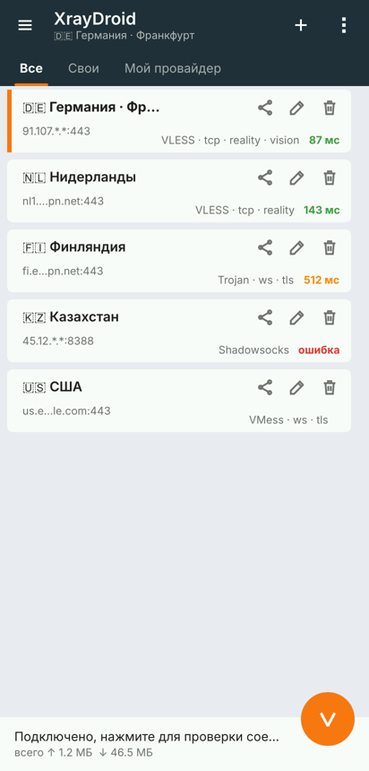
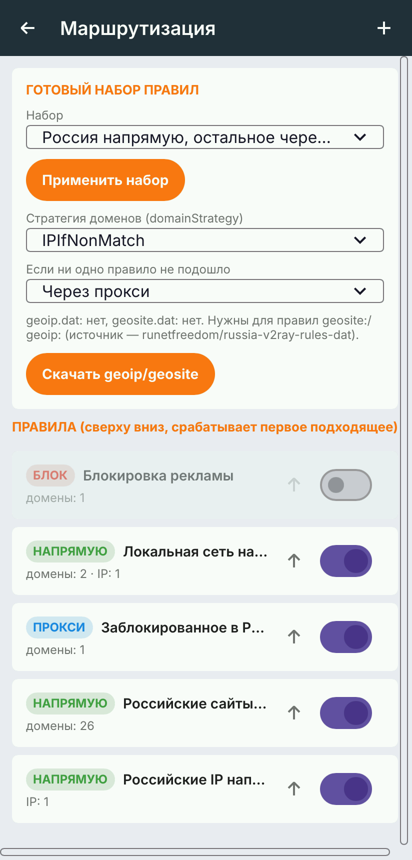
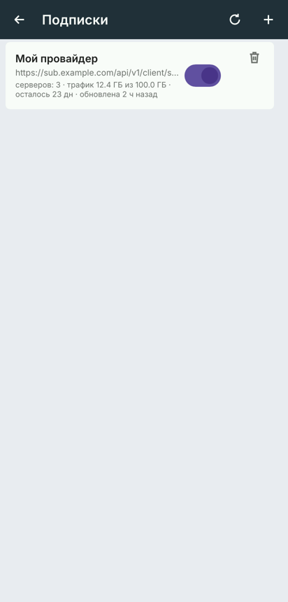

# XrayDroid

VPN-клиент для Android в духе **v2rayN / v2rayNG**, полностью написанный на **Rust**: собственное ядро протоколов и интерфейс на [Slint](https://slint.dev). На Java — только обязательная прослойка Android (`NativeActivity`, `VpnService`, плитка в шторке).

| Главный экран | Маршрутизация | Подписки |
|---|---|---|
|  |  |  |

## Возможности

**Протоколы** (собственная реализация, проверена против Xray-core 26.3):
- **VLESS**:
  - **XTLS Vision** (`xtls-rprx-vision`, `-udp443`) поверх REALITY, обычного TLS 1.3 или VLESS Encryption — с переходом в direct-режим, как в Xray;
  - **VLESS Encryption** — постквантовое шифрование Xray (`mlkem768x25519plus`: ML-KEM-768 + X25519, режимы `native`/`xorpub`/`random`, паддинг);
  - UDP: обычный, а через Vision — **XUDP** (Mux.Cool), как в Xray;
  - для Vision+TLS — собственный TLS 1.3-клиент с полной проверкой сертификата (цепочка, имя, CertificateVerify).
- VMess AEAD (aes-128-gcm, chacha20-poly1305)
- Trojan
- Shadowsocks: AEAD и 2022 (`2022-blake3-*`)
- **Hysteria2** (QUIC, аутентификация по HTTP/3, UDP-датаграммы с фрагментацией, обфускация **Salamander**)
- **TUIC v5** (QUIC, токен из TLS Keying Material, UDP в режиме native)
- **AnyTLS** (sing-box)
- SOCKS5, HTTP/HTTPS-прокси (CONNECT)

**Транспорты:**
- TCP (raw), в том числе с HTTP-маскировкой (`headerType=http`)
- TLS и REALITY
- WebSocket, HTTPUpgrade
- gRPC — режимы `gun` и `multi`, h2c / TLS / REALITY
- XHTTP (SplitHTTP) — режимы `auto`, `stream-one`, `stream-up`, `packet-up`, h2c / TLS / REALITY

Hysteria2, TUIC и AnyTLS проверены против sing-box 1.14, остальное — против Xray-core 26.3; все комбинации — в обе стороны (скачивание и загрузка по 20 МБ). UDP работает через VLESS, VMess, Trojan и Shadowsocks.

**Как в v2rayNG:**
- импорт ссылок `vless:// vmess:// trojan:// ss:// hysteria2:// hy2:// tuic:// anytls:// socks:// http(s)://` из буфера обмена, экспорт и шаринг;
- **подписки**: добавление по URL (или просто скопируйте `https://…` и нажмите «Импорт»), вкладка для каждой подписки, название и остаток трафика/срок из заголовков `profile-title` и `subscription-userinfo`, автообновление раз в сутки;
- тест реальной задержки для всех серверов, сортировка, удаление дубликатов и недоступных;
- раздельное туннелирование по приложениям (только выбранные / все, кроме выбранных);
- локальный SOCKS5-прокси, плитка в шторке быстрых настроек, уведомление со скоростью.

**Маршрутизация** (как в Xray):
- правила по доменам: `domain:`, `full:`, `keyword:`, `regexp:`, `geosite:категория[@атрибут]`;
- по IP: адреса и подсети IPv4/IPv6, `geoip:ru`, `geoip:private`, `!geoip:…`;
- по портам, сети (TCP/UDP) и протоколу из сниффинга (`tls`, `http`);
- действия: через прокси / напрямую / блокировать; порядок правил, включение/выключение;
- стратегии `AsIs`, `IPIfNonMatch`, `IPOnDemand`;
- готовые наборы: «Россия напрямую», «Через прокси только заблокированное в РФ», «Обход локальной сети», «Всё через прокси», «Всё напрямую»;
- загрузка `geoip.dat`/`geosite.dat` (по умолчанию — [runetfreedom/russia-v2ray-rules-dat](https://github.com/runetfreedom/russia-v2ray-rules-dat)).

**Сеть:** userspace TCP/IP-стек поверх TUN, FakeDNS (домены уходят на сервер, а не резолвятся локально), сниффинг SNI/Host, IPv6, блокировка QUIC по желанию.

## Установка

Готовый APK собирается в GitHub Actions: вкладка **Actions → Android APK → Artifacts**. Каждый push в `main` (в том числе слияние PR) собирает APK и публикует новый релиз во вкладке **Releases**. Версия: `<версия из Cargo.toml>-build.<номер запуска>`, например `0.2.0-build.42`.

## Сборка вручную

Нужны: Rust (stable), Android SDK (platform 35, build-tools 35), NDK r27, JDK 17+, `cargo install cargo-ndk`.

```bash
rustup target add aarch64-linux-android armv7-linux-androideabi x86_64-linux-android
export ANDROID_HOME=~/Android/Sdk
GRADLE=./gradlew ./build-android.sh          # все ABI
TARGETS=arm64-v8a GRADLE=./gradlew ./build-android.sh   # только arm64
```

APK: `android/app/build/outputs/apk/release/app-release.apk`.

APK подписывается ключом из `android/signing/` — он нужен, чтобы обновления ставились поверх. Для публичного распространения замените его своим (пароли берутся из `XD_STORE_PASSWORD`/`XD_KEY_PASSWORD`).

## Структура

```
core/      ядро: протоколы, транспорты, TUN, DNS, маршрутизация, подписки
  src/proxy/      vless, vision, vmess, trojan, shadowsocks, socks
  src/transport/  tcp/tls/ws/httpupgrade, reality (свой TLS 1.3-клиент)
  src/route/      правила, geosite/geoip, готовые наборы
  src/tun/        TUN-устройство, FakeDNS, сниффинг
  examples/itest.rs  утилита для проверки против настоящего Xray-сервера
app/       интерфейс на Slint + JNI-мост
  ui/main.slint   все экраны
  src/bin/screens.rs  рендер скриншотов интерфейса на ПК без эмулятора
android/   Gradle-проект: MainActivity, XrayVpnService (процесс :vpn), плитка
```

## Тесты

```bash
cargo test -p xd-core
cargo run -p xd-core --release --example itest -- socks '<ссылка>' 10808   # SOCKS5 через сервер из ссылки
```

## Ограничения

- нет mKCP и WireGuard; у Hysteria2 нет port hopping и Brutal (используется BBR); UDP через AnyTLS не поддерживается; XHTTP только поверх HTTP/2 (без HTTP/3 и раздельного `downloadSettings`);
- Vision поверх TLS требует TLS 1.3 на сервере (как и в Xray);
- нет сканера QR-кодов и Mux.

## Лицензия

GPL-3.0-or-later.
